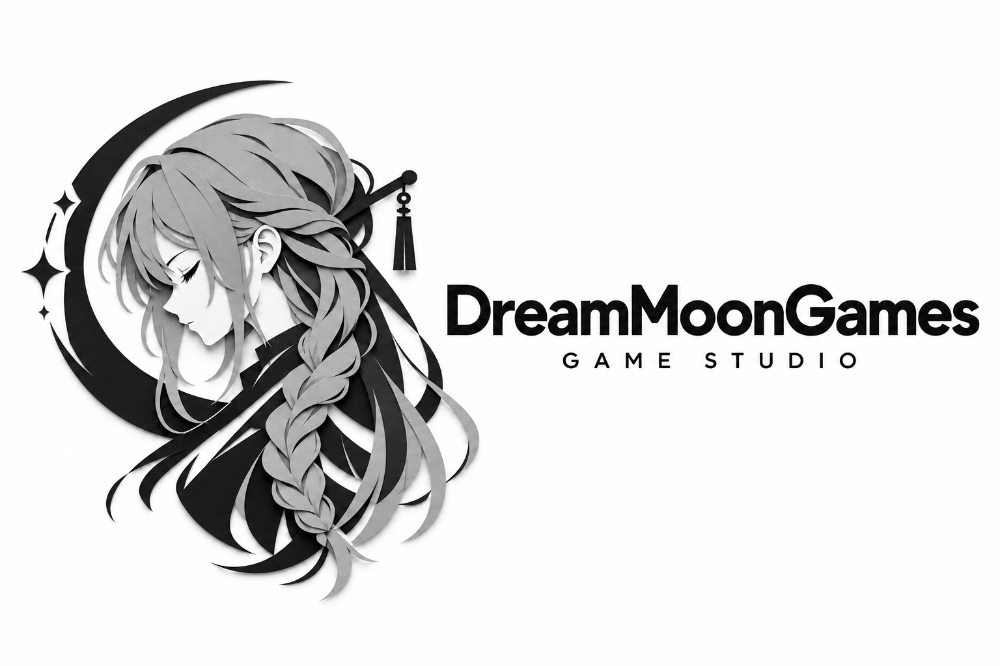
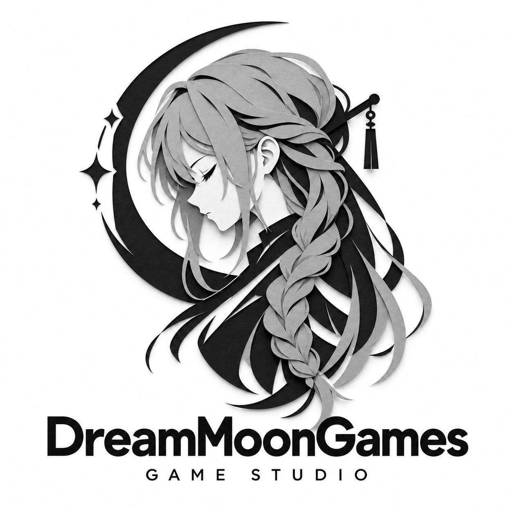
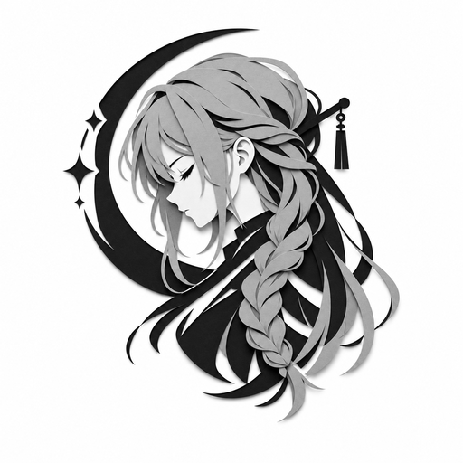
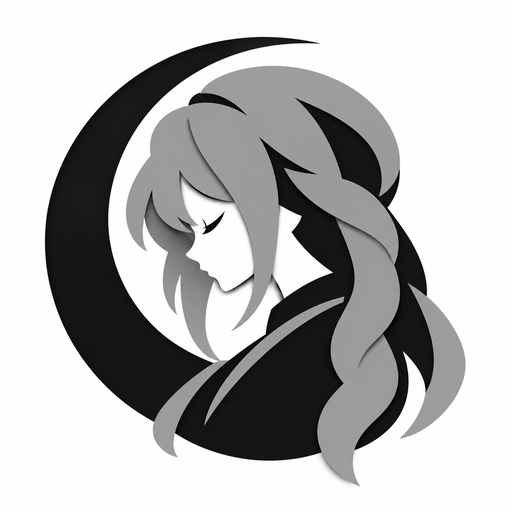

# Dream Moon Games

**An independent game studio building dreamlike worlds on Unreal Engine.**
*纸月为梦，游戏为乡。*

---

## About

Dream Moon Games is a small independent studio. We care about atmosphere over spectacle: quiet
moments, hand-crafted paper-cut silhouettes, moonlight, and stories told with restraint.

Our work is built end-to-end on **Unreal Engine 5** — from custom rendering and VFX systems to the
interface layer that sits in front of them.

> We are early. Most of what we build is still behind closed doors — this page is the front door.

## What we build

| Area | Description |
| :--- | :--- |
| **Games** | Original single-player titles with a monochrome, storybook art direction. |
| **Engine tech** | In-house Unreal Engine plugins for effects, shading and UI. |
| **Tools** | Internal pipelines and editor tooling that keep a tiny team fast. |

### In-house engine work

- **DreamFX** — effect authoring and runtime systems for stylised, paper-cut visuals.
- **DreamShader** — our shader library and material layer on top of Unreal's material system.
- **DreamGUI** — a lightweight UI framework for building game front-ends in engine.

> These plugins are currently internal; public releases will be announced here first.

## The mark

The logo is a paper-cut emblem: a girl in profile, eyes closed, head bowed — plus a crescent moon
for the *Moon* in our name. Black, white and one grey. No colour, no gradient, no noise.
The whole identity is built from stacked paper layers, so the mark keeps its depth at any size.

&nbsp;&nbsp;&nbsp;

&nbsp;&nbsp;&nbsp;

## Projects

| Project | Type | Status |
| :--- | :--- | :--- |
| *Untitled project* | Single-player narrative game (UE5) | In development |
| DreamFX / DreamShader / DreamGUI | Unreal Engine plugins | Internal |
| `ring-development-docs` | Studio documentation | Private |

## Tech

`Unreal Engine 5` · `C++` · `Blueprints` · `Python` (editor tooling) · `HLSL` · `Perforce` / `Git`

## Get in touch

- **GitHub** — you are here. Open an issue in the relevant repository.
- **Business / press** — *(contact details coming soon)*

<!--
  TODO before publishing:
  - replace the "contact details coming soon" line with a real address
    (e.g. hello@dreammoongames.com) or a Discord / X / Bilibili link
  - update the Projects table once the first title is announced
-->

---

© Dream Moon Games · All artwork and logos are the property of Dream Moon Games.

